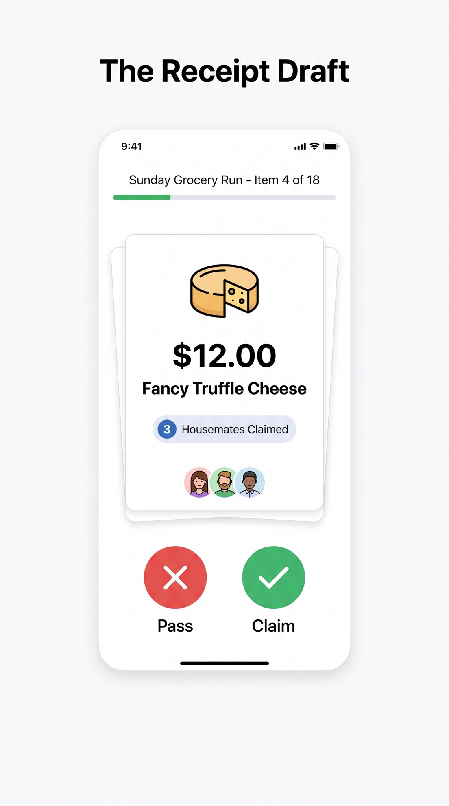
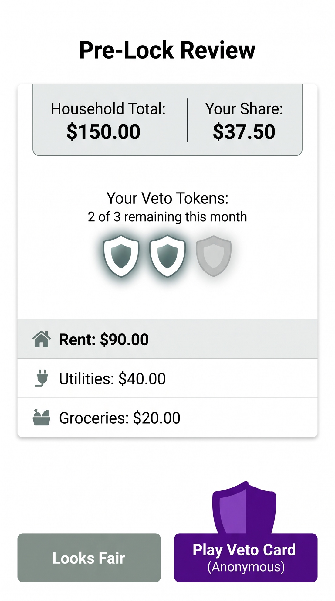
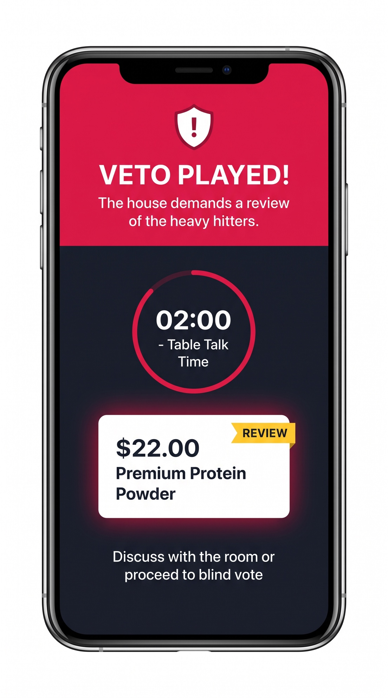
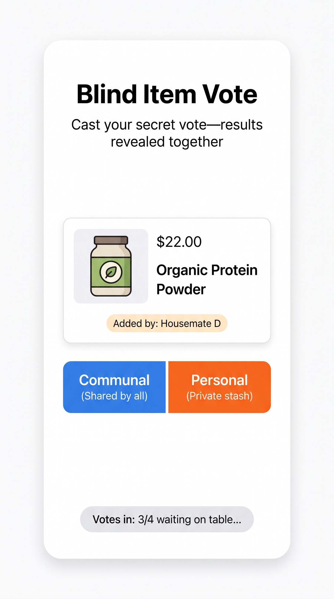
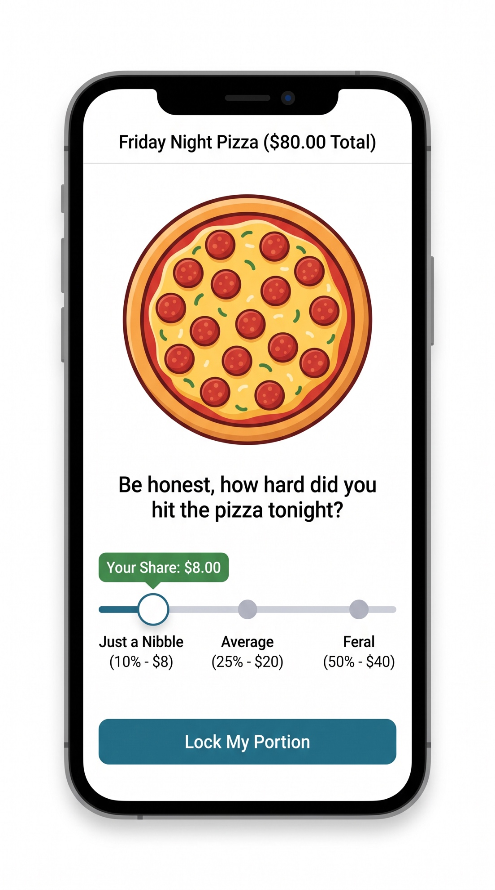
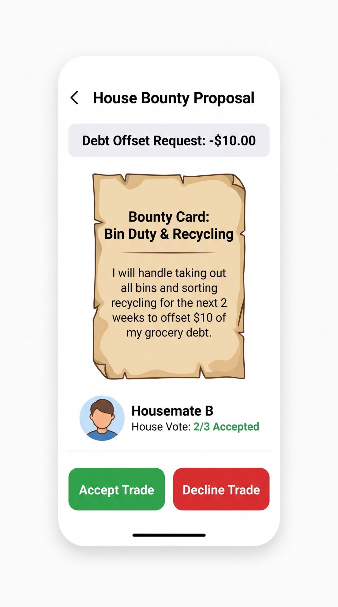

# Prototype

**The Weekly Split** is a mid-fi mobile web ritual. Four housemates. One receipt. About ten minutes. No extra software. The brief asked for a link that runs without installing anything. This is that link.

**Open the prototype:** [https://malonewayne.github.io/Deco3500-Team-17/](https://malonewayne.github.io/Deco3500-Team-17/)

If that 404s, the repo owner still needs to turn on GitHub Pages. Local fallback (still no extra app store install):

```bash
cd weekly-split
npm install
npm run dev
```

Then open `http://localhost:5173/`.

Code: [`weekly-split/`](https://github.com/MaloneWayne/Deco3500-Team-17/tree/main/weekly-split)  
Screen flows: [`Ruize Ma/`](https://github.com/MaloneWayne/Deco3500-Team-17/tree/main/Ruize%20Ma) (home, receipt, claim/pass, item result, review/veto, lock)

## What you can do

The prototype is not a poster. The core loop runs.

0. **Create a receipt.** Before anyone claims anything, the house writes the receipt up together. Any seated housemate can enter the receipt name and pick who paid, add each item's name and price, and edit or remove items while the running total updates on every phone. Each item remembers who added it, which the blind vote uses later. An optional **Shared food** tick sends an item to the slider instead of the communal/personal vote if the bill is vetoed. **Start splitting** hands the list to the claim/pass round. For test sessions, **Fill in the sample receipt instead** loads the seven-item demo week (Drew paid). *(Team decision after the latest group discussion: the house needs to enter its own items, not only play a seeded receipt.)*
1. **Receipt draft.** Each item lands on every phone. A progress bar shows the receipt name and "Item 4 of 7." Swipe right or tap the green ✓ to claim, swipe left or tap the red ✕ to pass. The card shows how many housemates claimed it, with their avatars. If three people claim the cheese, it splits three ways. If one claims it, they pay it. If **nobody** claims an item (the cleaner, usually), it is split evenly across the whole house. *(R3, R6: item-level, not only a house total.)*
2. **Pre-lock review and anonymous veto.** Before lock, every phone shows the household total next to your share, the bill by category, and everyone's share. Each person taps **Looks Fair** or **Play Veto Card (Anonymous)**. Each housemate has **3 veto tokens a month**. They are counted only on their own phone, so spending one never tells the table who vetoed. *(R1, R5. P05: let the app say the item needs review.)*
3. **Veto played · table talk.** If anyone vetoes, every phone turns red: "VETO PLAYED! The house demands a review of the heavy hitters." A 2-minute Table Talk countdown runs over the contested items, each flagged REVIEW. The house can discuss, or everyone taps **Proceed to blind vote** to skip ahead.
4. **Blind item vote.** Luxury items: **Communal (shared by all)** or **Personal (private stash)**, with "Added by" shown. "Votes in: 3/4" counts answers without naming them. All results are revealed together. Personal items go to whoever put them in the cart. *(R6. This is P04’s milk problem.)*
5. **The slider of fairness.** Shared food such as pizza is the wrong fit for personal vs communal, so it gets three stops: Just a Nibble (10%), Average (25%), Feral (50%). Each stop shows the dollar share, then **Lock My Portion**. Shares are rescaled so the item still adds up to its price.
6. **House bounty.** If you still owe, you can play a bounty card: a first-person offer such as "I will take out all the bins and sort recycling for the next 2 weeks to offset $10 of my debt." The others tap **Accept Trade** or **Decline Trade** in secret; only the tally is shown. *(R7. Interviews said informal trades work; priced chores start a second fight.)*
7. **Lock.** When everyone taps **Ready to lock the bill**, the house sees who pays whom, and the item maths stays visible. *(R2, P06: explain the result.)*

**What we cut: the orphan spinner.** Earlier versions spun a ten-second wheel to decide who paid for an unclaimed item. Participants in the prototype interviews consistently called it unfair for shared essentials ([Methods](Methods.md)), so the group removed it. Unclaimed items are now split evenly; nobody is singled out by chance.

### Concept screens

The team drew the target screens with AI image tools. The prototype now follows them, using the existing paper-and-ink colours.

| | | |
| --- | --- | --- |
|  |  |  |
| Receipt Draft | Pre-Lock Review | Veto Played · Table Talk |
|  |  |  |
| Blind Item Vote | The Slider of Fairness | House Bounty Proposal |

Two places where the build differs from the drawings on purpose. The bounty screen shows how many votes are in during voting, not how many accepted, so early votes cannot be guessed. The concept's rent and utilities rows are replaced by the receipt the house entered, who paid it, and any unclaimed items.

**Live table, one phone each.** One housemate opens a 4- or 5-person table and shares a 4-letter code. Everyone else joins on their own phone and takes a seat. From then on the receipt entry, the swipes, the veto, the table-talk timer, the blind votes, the bounties and the final bill stay in sync on every phone. The host phone acts as referee. Veto, review and bounty choices go only to its private tally, so the table learns *that* a veto was played but never *who* played it. *(C7. In Test-P1 and Test-P2 both participants asked who had vetoed, so the veto screen now also says in one line that nobody is named.)* If a phone drops, the host can hand that seat to an NPC. If the host phone closes, the next phone takes over. Empty seats can still be NPC for a solo demo.

## How good design practice shows up

**The system takes the heat.** HCI for this problem is not prettier charts. It is moving the accusation off the human. P04 already felt like an accuser for naming protein powder. The red veto screen is loud on purpose. It gives the room a two-minute script — talk about the items, not the person — so nobody starts a witch hunt.

**Same item, same time.** Splitwise is async. P01 never sits together to calculate. We deal the receipt like a deck so the house stays in one beat.

**Anonymity is for input, not for geography.** People sit together. Votes stay on-device. P06 wanted both: hide the voter, show the outcome.

**Labour is money, but only if the house says yes.** Bounty cards refuse “dollars only.” They also refuse a silent conversion of the poorest housemate into unpaid cleaner.

**Progressive commitment.** Claim first. Veto only if the totals still feel wrong. Do not start with a court case.

**No install.** A webpage matches “Sunday, kitchen, now” (P06 already treats Sunday as the settle night).

**Visual + playable.** The Ruize Ma screens show the social beat (claim, result, veto, lock). The web app has to do the maths. Both are the prototype. One is how it should feel. One is how it actually runs.

## What is still mid-fi

NPC housemates auto-swipe so a single demo phone can finish the ritual. Items are typed in by hand: there is no OCR of a Woolies receipt, no accounts, no bank payout. One receipt per round, with one payer. Sync runs through a free public test server, so the receipt screen asks for made-up items, and the seats use fake names. The social mechanics are the high-fidelity part. The plumbing is not.

How to test this with real housemates: [Testing Plan](Testing-Plan.md).
